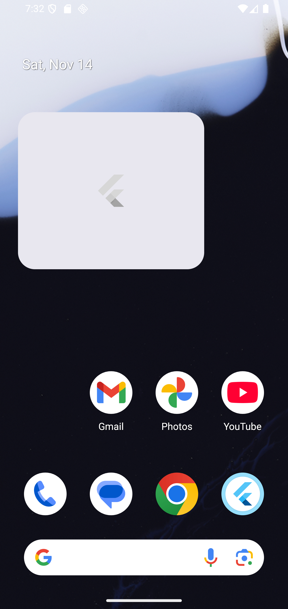
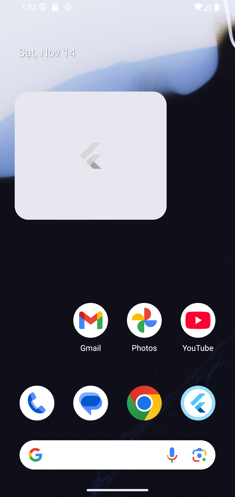
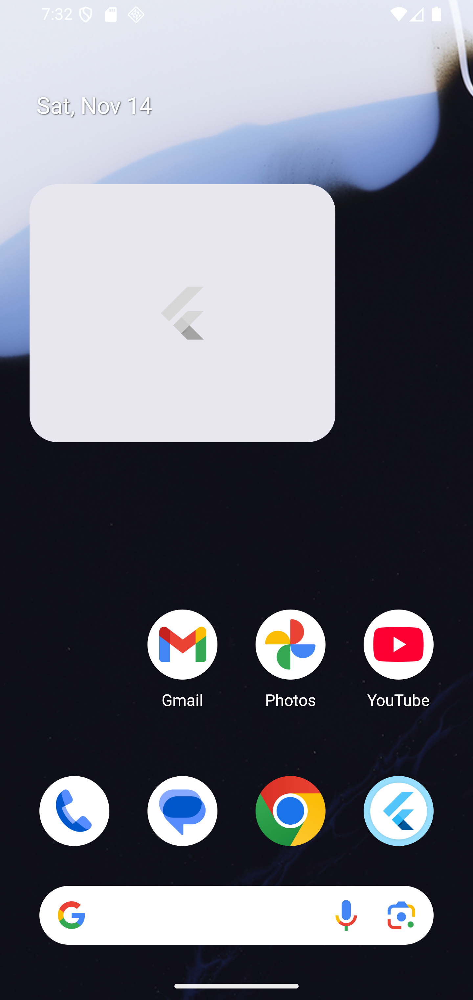
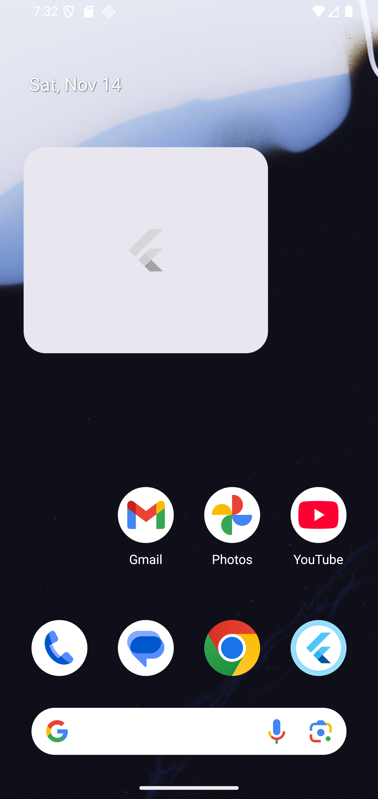

# MindSpark

A motivation app for Android: a daily quote on your home screen, a searchable quote library, goals with streaks, and optional accounts that sync across devices. Built with Flutter, Kotlin and a Node.js API.

## Screenshots

| Home | Library | Goals | Goal detail | Settings |
|---|---|---|---|---|
|  |  |  |  |  |

## Features

- **Daily quote** on Home, chosen from the interests you pick during onboarding.
- **Quote library**: search by text, author or tag, category filters, three sort orders, detail view.
- **Favorites** and **native share**.
- **Android home-screen widget** (small and medium) with a Next button and a deep link into the app. Works offline from a native cache.
- **Goals**: a daily action, milestones, a target date, daily check-ins, and current and longest streaks. A check-in yesterday keeps a streak alive.
- **Daily reminder**: a notification with a quote at a time you choose, including the Android 13 permission flow.
- **Accounts** (optional): sign up and sign in, session kept in secure storage. Favorites, settings and goals sync to your account and work offline.
- Light and dark themes. The app is fully usable as a guest.

## Tech stack

| Part | Technology |
|---|---|
| App | Flutter (Material 3), Riverpod, go_router, shared_preferences, flutter_secure_storage |
| Android native | Kotlin: share sheet, home-screen widget, reminder alarm and notification (platform channels) |
| API | Node.js, Express, Mongoose (MongoDB), zod, JWT, bcryptjs, helmet, express-rate-limit, pino |
| Tests | Flutter test, Jest, supertest, mongodb-memory-server |
| CI | GitHub Actions |

## How it fits together

The app is **local-first**: everything works offline and is saved on the device. Signed-in users additionally sync with the API. Per goal, the newer change wins. Check-ins are calendar dates (YYYY-MM-DD) in the user's own time zone, so streaks do not depend on UTC offsets.

## Getting started

Requirements: Flutter (stable), Node.js 20 or newer, an Android emulator or phone.

**Backend** (no database setup needed for development; it starts a temporary in-memory MongoDB with the quotes loaded):

```bash
cd backend
npm install
cp .env.example .env        # Windows: Copy-Item .env.example .env
# set JWT_SECRET to a random string of at least 32 characters
npm run dev:local
npm test
```

**App**:

```bash
flutter pub get
flutter run                 # the Android emulator reaches the API at http://10.0.2.2:3000/api
flutter analyze
flutter test
```

To use another API address:

```bash
flutter run --dart-define=API_BASE_URL=https://your-host.example/api
```

Plain HTTP is allowed in debug builds only (see `android/app/src/debug/AndroidManifest.xml`).

## API overview

All JSON. Protected routes need `Authorization: Bearer <token>`.

| Area | Endpoints |
|---|---|
| Health | `GET /api/health` |
| Quotes | `GET /api/quotes` (search, category, sort, page), `/random`, `/categories`, `/category/:category`, `/:id` |
| Auth | `POST /api/auth/register`, `POST /api/auth/login`, `GET /api/auth/me` |
| Account | `GET` and `PATCH /api/users/preferences`, `DELETE /api/users/me` |
| Favorites | `GET /api/favorites`, `POST /api/favorites/merge`, `POST` and `DELETE /api/favorites/:quoteId` |
| Goals | `GET` and `POST /api/goals`, `GET`, `PATCH`, `PUT` and `DELETE /api/goals/:id`, `POST /api/goals/:id/check-ins`, `DELETE /api/goals/:id/check-ins/:date` |

## Configuration (backend)

| Variable | Meaning | Default |
|---|---|---|
| `JWT_SECRET` | Signing secret, at least 32 characters | required |
| `MONGODB_URI` | MongoDB connection string | none (needed for `npm start`) |
| `PORT` | HTTP port | 3000 |
| `CORS_ORIGIN` | Allowed browser origins, comma separated | none |
| `RATE_LIMIT_MAX` | Requests per 15 minutes per IP | 100 |
| `AUTH_RATE_LIMIT_MAX` | Sign-in and sign-up attempts per 15 minutes per IP | 20 |
| `JWT_EXPIRES_IN` | Token lifetime | 7d |
| `BCRYPT_ROUNDS` | Password hashing cost | 12 |
| `LOG_LEVEL` | pino level | info |

## Security notes

- Passwords are hashed with bcrypt. The JWT algorithm is pinned (HS256) and tokens are checked against the stored account.
- Every request body is validated with zod and rejects unknown fields. Every user-owned query is scoped to the signed-in user, and another user's data answers 404.
- Auth endpoints are rate limited. Security headers come from helmet.
- The app keeps its session in the Android Keystore through flutter_secure_storage. No secrets are stored in the repository.

## Limitations

- If the same goal is changed on two devices while both are offline, the later change wins and the other is lost.
- Sync times come from device clocks. The server rejects times far in the future.
- Reminders use inexact alarms (no special permission), so they can arrive a few minutes late when the phone saves battery.
- The development database is in memory, so accounts disappear when the dev server stops.

## Roadmap

Firebase Analytics and Crashlytics, push notifications, an AI goal coach (with the key kept on the server), deployment with MongoDB Atlas, and a signed release build.

## License

MIT. See [LICENSE](LICENSE).
